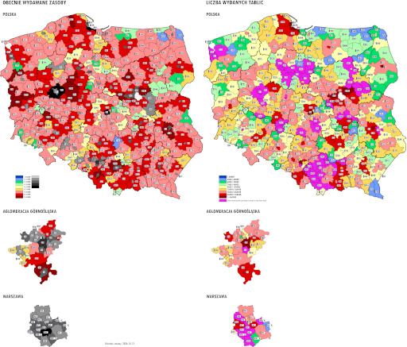

+++
date = '2026-10-13T18:20:23+02:00'
draft = false
title = '2026-10-13'
+++

Ostatnie zmiany:
<!--more-->

* obecnie wydawane zasoby:
  * **NIL** &mdash; *VIII* zasób,
  * **WKZ** &mdash; *V* zasób,
* liczba wydanych tablic:
  * **BAU** &mdash; *V* zasób,
  * **BLM** &mdash; *V* zasób,
  * **CCH** &mdash; *V* zasób,
  * **GSZ** &mdash; *III* zasób,
  * **LZA** &mdash; *VII* zasób,
  * **RKR** &mdash; *VII* zasób,
  * **WWL** &mdash; *IX* zasób

