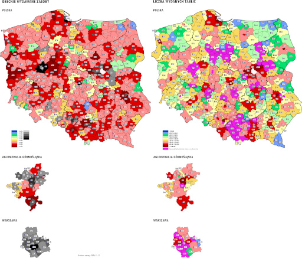

+++
date = '2026-11-17T14:00:23+02:00'
draft = false
title = '2026-11-17'
+++

Ostatnie zmiany:
<!--more-->

* obecnie wydawane zasoby:
  * **FWS** &mdash; *V* zasób,
  * **FZA** &mdash; *VIII* zasób,
  * **SZO** &mdash; *VI* zasób,
  * **FZ** &mdash; *III* zasób,
  * **OOL** &mdash; *VI* zasób
* liczba wydanych tablic:
  * **DLB** &mdash; *V* zasób,
  * **NEB** &mdash; *V* zasób,

